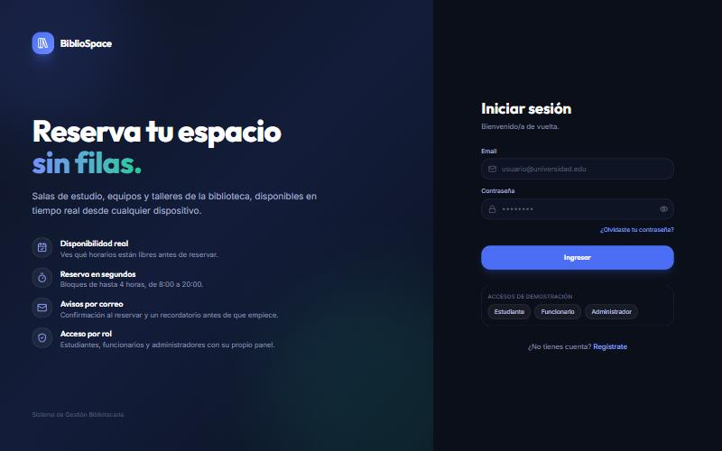
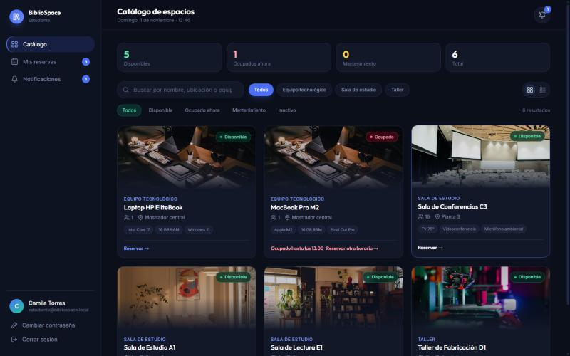
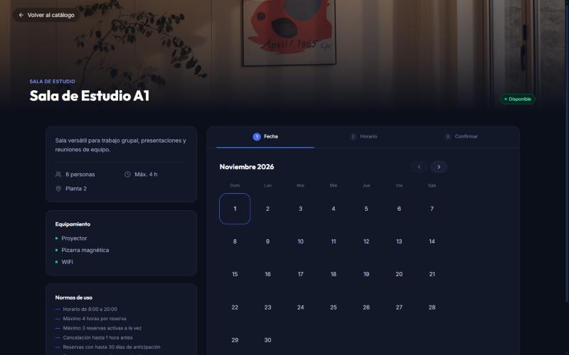
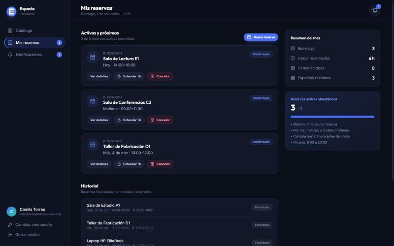
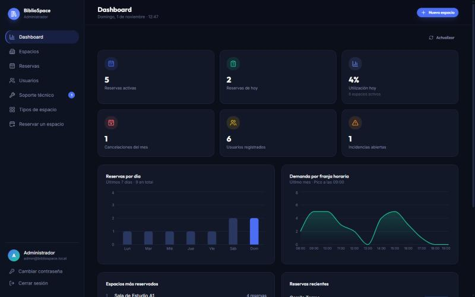
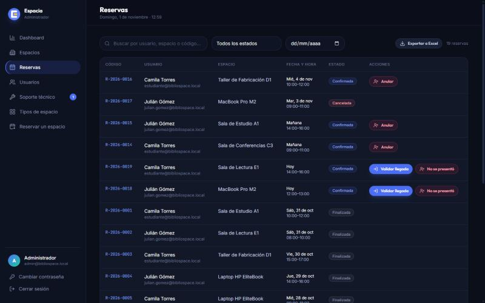

# Espacia — Frontend

Aplicación web para reservar salas de estudio, equipos y talleres de la biblioteca.
React 19 · Vite · TypeScript · Tailwind CSS 4.

Necesita el backend de [Espacia-Backend](https://github.com/Sebxx66/Espacia-Backend) funcionando (por defecto en `http://localhost:8080`).

## Vista previa

| Inicio de sesión | Catálogo de espacios |
|---|---|
|  |  |

| Reservar un espacio | Mis reservas |
|---|---|
|  |  |

| Panel del administrador | Gestión de reservas |
|---|---|
|  |  |

## Puesta en marcha

1. Levanta la base de datos y el backend (ver el README del backend).
2. Instala las dependencias y arranca el frontend:

   ```bash
   npm install
   npm run dev
   ```

3. Abre la URL que muestra Vite (por defecto `http://localhost:8443`).

El frontend no llama al backend directamente: usa la ruta `/backend`, que el servidor de desarrollo reenvía a `http://localhost:8080`. Para apuntar a otro backend, copia `.env.example` a `.env.local` y define `BACKEND_URL`.

### Abrir en el celular

1. Conecta el celular a la misma red Wi-Fi que el PC.
2. Abre la app en el PC (`http://localhost:8443`). En la pantalla de inicio, al pie del panel izquierdo, aparece la tarjeta **"Ábrelo en tu celular"** con un código QR.
3. Escanéalo con la cámara del celular.

El QR se genera en el navegador con la IP actual del PC y se actualiza solo si el PC cambia de red. Solo aparece cuando la app se abre en el propio PC (no en el celular) y en pantallas grandes.

Si no carga en el celular:

- **Firewall de Windows:** permite Node.js en redes privadas, y marca la red Wi-Fi como privada.
- **iPhone con "Advertir sobre conexiones no seguras" activado:** Safari bloquea las páginas `http://`. Desactívalo en **Ajustes → Apps → Safari** mientras uses la app en la red local.
- **Redes públicas o de universidades:** suelen aislar los dispositivos entre sí. Usa la red de casa o el hotspot del celular.

### Primer ingreso

- **Estudiantes:** "Regístrate" en la pantalla de inicio (contraseña de al menos 8 caracteres). Recibirás un correo de bienvenida si el backend tiene el correo configurado.
- **Administrador:** usa la cuenta inicial que crea el backend (ver su README) y cambia la contraseña.
- **Funcionarios:** los crea el administrador desde **Usuarios → Nuevo usuario**.
- **Recuperar contraseña:** "¿Olvidaste tu contraseña?" envía un enlace al correo registrado.

Con `npm run dev`, la pantalla de inicio muestra atajos de **accesos de demostración** que rellenan las cuentas de ejemplo del backend. No aparecen en la versión compilada (`npm run build`).

## Qué puede hacer cada rol

**Estudiante**
- Catálogo con búsqueda, filtros por tipo y estado, y ocupación en tiempo real.
- Reservar eligiendo fecha y horario según la disponibilidad real, con límite de 1 equipo y 2 salas por día.
- Mis reservas: ver detalle, extender 1 hora, cancelar, historial y resumen del mes.
- Notificaciones de confirmaciones, cancelaciones, llegadas y devoluciones.

**Funcionario**
- Llegadas de hoy: validar la llegada o marcar a quien no se presentó.
- En uso: registrar devoluciones de equipos y el fin de uso de los espacios.
- Monitor de espacios, reservas del día y soporte técnico (incidencias y mantenimiento).

**Administrador**
- Dashboard con estadísticas reales.
- Gestión de espacios, reservas, usuarios (roles, suspensión, restablecer contraseña), incidencias y tipos de espacio.
- Exportación de las reservas filtradas a un archivo que abre Excel.

Los tres roles pueden cambiar su contraseña desde el menú lateral.

## Estructura

| Ruta | Contenido |
|---|---|
| `src/api.ts` | Cliente del backend: sesión JWT, llamadas y traducción de roles y estados |
| `src/App.tsx` | Navegación entre pantallas según el rol |
| `src/screens/` | Login y registro, panel de estudiante, detalle y reserva de un espacio, paneles de funcionario y administrador |
| `src/components/ui.tsx` | Botones, formularios, modales, toasts y estados de carga, error y vacío |
| `src/components/AppShell.tsx` | Menú lateral (cajón en celular), cabecera y cambio de contraseña |
| `src/components/staff.tsx` | Acciones sobre reservas e incidencias, compartidas por funcionario y administrador |
| `src/components/PhoneQr.tsx` | Tarjeta con el QR para abrir la app en el celular |
| `src/lib/` | Formato de fechas y estados, exportación a CSV, generador de códigos QR (`qr.ts`) y el hook `useLoader` |

## Scripts

| Comando | Uso |
|---|---|
| `npm run dev` | Servidor de desarrollo |
| `npm run build` | Compilación para producción en `dist/` |
| `npx tsc --noEmit` | Verificación de tipos |

## Versión compilada

`npm run build` genera `dist/` sin el servidor de desarrollo, así que ahí no existe el reenvío de `/backend`. Define `VITE_API_URL` con la URL pública del backend antes de compilar y agrega el dominio del frontend en `CORS_ALLOWED_ORIGINS` del backend.

## Historial de cambios

Ver [CHANGELOG.md](CHANGELOG.md).

## Imágenes

Las fotos de los espacios se cargan desde Unsplash (licencia libre, uso comercial permitido). Si no hay conexión se muestran las ilustraciones de `public/spaces/`.
